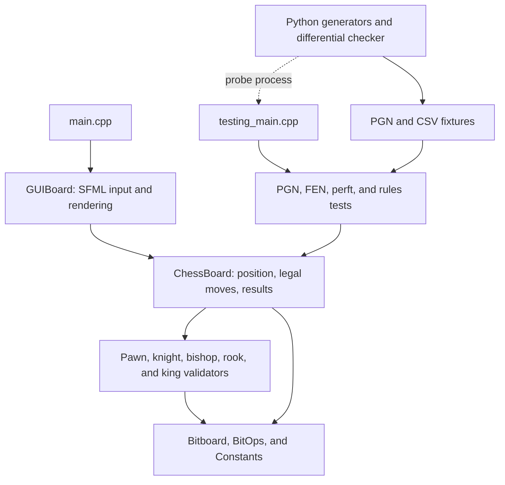

# Architecture and File Guide

This guide describes the current repository and the purpose of its files. Paths are relative to the repository root unless a section says otherwise. Header/implementation pairs share a row, with each file's role described separately. Repeated assets and generated build files are grouped by naming pattern.

For bitboard formulas and detailed chess rules, see [ENGINE.md](ENGINE.md). For rule coverage and known limits, see [RULES_AUDIT.md](RULES_AUDIT.md).

## General Architecture

The project is a C++17 chess rules engine with an optional SFML board interface and a separate headless test executable. It represents positions, generates legal moves, applies moves, imports games, and determines game results. There is currently no position evaluation, best-move search, or computer opponent. `movePieceUCI()` accepts UCI coordinate notation; it is not a UCI engine protocol server.

### Responsibilities and Dependencies

- **Application layer:** `main.cpp` starts the GUI application; `GUIBoard` renders a referenced `ChessBoard` and translates user input into board operations. SFML stays in these files.
- **Rules and state layer:** `ChessBoard` owns the position and game state. SAN, UCI, and direct coordinate moves use its common legality and application logic. PGN replay also lives here; `PGNTestRunner` handles discovering and reporting test games.
- **Movement layer:** piece validators calculate local movement and attack masks using board occupancy. `ChessBoard` combines them and enforces king safety and special rules. Queens combine bishop and rook attacks rather than having a separate validator.
- **Representation layer:** bitboard types, square masks, bit scans, occupancy enumeration, and magic-table helpers support the movement layer without requiring SFML.
- **Verification layer:** C++ runners exercise the same engine API as the GUI. Python scripts generate fixtures or compare results with `python-chess`; Python is not a runtime dependency of the C++ engine.

`CMakeLists.txt` compiles the shared engine source files directly into each executable. It does not currently create a separate engine library target. Its source glob includes test helper implementations in the shared source set, while excluding application entry points, GUI code, and `RulesTests.cpp`. The GUI target adds `main.cpp` and `GUIBoard.cpp`; the test target adds `testing_main.cpp` and `RulesTests.cpp`.

### Position Representation

`ChessBoard` maintains two synchronized views: `char board[8][8]` for square lookup and display, and twelve 64-bit piece bitboards, one for each piece/color combination, for occupancy and attacks. Array row 0 is rank 8; bit 0 is `a1`, and bit 63 is `h8`. The conversion is `(7 - row) * 8 + col`.

The board also stores the side to move, castling rights, en-passant target, halfmove/fullmove counters, result flags, and repetition counts. FEN loads and exports the six position fields; loading a FEN replaces the position and starts new repetition history. FEN cannot supply earlier game history.

`getAllMoves()` returns a map from a one-bit origin mask to a destination mask. That representation stores destinations rather than full move objects, so promotion choices must be supplied separately. Perft explicitly expands each promotion destination into four moves.

### Move Lifecycle

1. The GUI supplies board coordinates, SAN input identifies a move by chess notation, or UCI input supplies source/destination squares and an optional promotion piece. PGN replay feeds mainline SAN moves into the same board API.
2. `ChessBoard` generates candidate destinations using the relevant validators. Pawns handle direction, pushes, captures, and en passant; knights and kings use precomputed masks; bishops and rooks use blocker-dependent magic attack tables initialized by their validators.
3. The board checks castling rights, rook presence, empty squares, and safe king paths. For each candidate move, it temporarily changes bitboard occupancy, including capture and en-passant removal, checks king safety, and restores the original bitboards. Generating moves leaves game results and history unchanged.
4. An accepted move updates piece placement, captures, promotion or castling, rights, the en-passant target, clocks, and the side to move. The square grid and bitboards remain synchronized.
5. With adjudication enabled, the board records repetition and updates checkmate, stalemate, material draws, the automatic 75-move draw, and fivefold repetition. Fifty-move draws require an explicit claim. Threefold claims are deliberately disabled.

Analysis fixtures and perft use `ChessBoard(fen, false)` to keep automatic draws from stopping legal-move exploration. This preserves move legality while disabling normal game adjudication. Material detection is conservative; there is no clock/flag-fall controller or general fortress solver.

## Engine Source Files

All paths in this section are under `cpp_chess_engine/`.

| File(s) | Purpose |
| --- | --- |
| `ChessBoard.hpp`, `ChessBoard.cpp` | The header declares the board API and owned state. The implementation handles initialization, FEN, square/bitboard synchronization, attacks, legal generation, move application, SAN/UCI parsing, PGN replay, castling, en passant, promotion, repetition, and game results. |
| `Bitboard.hpp` | Defines the `uint64_t`-based `Bitboard` type and `Magic` metadata containing an occupancy mask, multiplier, attack-table pointer, and shift. |
| `BitOps.hpp`, `BitOps.cpp` | The header declares bit scans, population counts, occupancy enumeration, and sparse random-number helpers. The implementation supplies these operations for move generation and magic-table construction. |
| `Constants.hpp` | Shared file/rank masks, initial piece placements, piece indexes, and castling constants. |
| `MoveValidator.hpp`, `MoveValidator.cpp` | The header defines the abstract `validate()` interface and virtual destructor. The `.cpp` is currently empty; concrete validators contain the behavior. |
| `PawnValidator.hpp`, `PawnValidator.cpp` | The header declares pawn validation, attack, and destination APIs. The implementation computes directional attacks, single/double pushes, captures, and en-passant candidates. Final king safety and promotion application belong to `ChessBoard`. |
| `KnightValidator.hpp`, `KnightValidator.cpp` | The header declares knight validation and its 64-square attack table. The implementation initializes jump masks and filters friendly occupancy. |
| `BishopValidator.hpp`, `BishopValidator.cpp` | The header declares bishop validation and magic tables. The implementation builds diagonal occupancy masks and blocker-dependent attack tables, then performs magic lookups. |
| `RookValidator.hpp`, `RookValidator.cpp` | The header declares rook validation and magic tables. The implementation builds rank/file occupancy masks and blocker-dependent attack tables, then performs magic lookups. |
| `KingValidator.hpp`, `KingValidator.cpp` | The header declares king validation and its attack table. The implementation generates adjacent-square masks. `ChessBoard` handles attacked destinations and castling. |
| `Move.hpp`, `Move.cpp` | The header defines a small `Move` struct with integer `from` and `to` fields. The implementation only includes the header; it contains no coordinate conversion or move-application logic. Legal generation currently uses bitboard maps instead of this struct. |
| `DataTypes.cpp` | Empty placeholder with no current engine behavior. |
| `KnightMoves.cpp` | Whitespace-only placeholder. Actual knight movement lives in `KnightValidator.cpp`. |

## Applications and Test Support

All paths in this section are under `cpp_chess_engine/`.

| File(s) | Purpose |
| --- | --- |
| `main.cpp` | GUI executable entry point. Runs PGN validation before opening a board initialized from a hardcoded FEN. Supports `--pgn-tests-only` and `--no-gui`; also contains older manual test examples. |
| `GUIBoard.hpp`, `GUIBoard.cpp` | The header declares the SFML board wrapper and its reference to `ChessBoard`. The implementation loads textures, draws the board, processes input, highlights moves, and presents four promotion choices. |
| `testing_main.cpp` | Current headless entry point. Runs PGN, CSV FEN, perft, and stateful rules suites with a combined exit status and runtime reporting. Accepts PGN/FEN/perft directory arguments, `--rules` for rule regressions only, or `--probe` for differential-check input/output. |
| `PGNTestRunner.hpp`, `PGNTestRunner.cpp` | The header exposes directory-based PGN testing. The implementation discovers games, calls board PGN validation, and reports pass/fail results and timing. |
| `FenMoveTester.hpp`, `FenMoveTester.cpp` | The header defines `FenMoveTestCase` and loading/running APIs. The implementation parses CSV fixtures, attempts SAN moves from FEN positions, and compares acceptance with the expected result. |
| `FENTestRunner.hpp`, `FENTestRunner.cpp` | Compatibility API for individual FEN/SAN tests and the default CSV suite. The implementation forwards to `FenMoveTester`, translating the older `shouldFail` argument to `shouldSucceed`. |
| `PerftTester.hpp`, `PerftTester.cpp` | The header defines perft cases and counting/loading APIs. The implementation recursively counts legal move sequences, expands promotions, reads depth settings, compares CSV reference counts, and prints root-branch counts on failure. |
| `RulesTests.hpp`, `RulesTests.cpp` | The header declares stateful regression and probe entry points. The implementation checks results, counters, bounds, FEN resets, promotion, castling, repetition, and PGN behavior, and implements the probe used by the Python differential checker. |
| `pgn_tester_main.cpp` | Older PGN/FEN-only entry point. Excluded from the current CMake targets; `testing_main.cpp` is the supported centralized runner. |

## Build, Configuration, and Repository Files

| File | Purpose |
| --- | --- |
| `CMakeLists.txt` | Canonical C++17 build definition. Controls `BUILD_GUI` and `BUILD_TESTING_MODULE`, fetches SFML 2.6.1 for GUI builds, creates the two executables, and registers the `chess_rules` CTest test. Headless builds require no SFML. |
| `CMakeSettings.json` | Visual Studio CMake configuration for an MSVC x64 Debug build using Ninja under `out/build/`. |
| `cpp_chess_engine.sln` | Legacy Visual Studio solution pointing to the project file below. |
| `cpp_chess_engine/cpp_chess_engine.vcxproj` | Legacy MSBuild project with its own source list and Windows build/link settings. CMake is the reference for the current GUI/headless target layout. |
| `test_config.env` | Shared perft depth setting, currently `PERFT_MAX_DEPTH=5`. Matching environment variables override file settings. |
| `.woodpecker.yml` | Woodpecker CI pipeline for push, pull request, and manual runs. Installs build tools in Alpine and invokes the headless test script. |
| `.vscode/launch.json` | VS Code GDB launch configuration targeting `build/cpp_chess_engine` with the repository as its working directory. |
| `.vscode/settings.json` | VS Code C++ file association for `type_traits`. |
| `.gitattributes` | Enables automatic Git text line-ending normalization; other examples are commented out. |
| `.gitignore` | Excludes common IDE, compiler, cache, and local build artifacts. Some generated files already tracked by Git may still appear in the repository. |
| `AGENTS.md` | Contributor/agent instructions covering project layout, builds, rule invariants, test fixtures, and documentation maintenance. |
| `README.md` | User-facing build and test instructions and links into the documentation. |
| `docs/ARCHITECTURE.md` | This architecture overview and file inventory. |
| `docs/ENGINE.md` | Detailed board model, move-generation pipeline, bit operations, special rules, and testing workflow. |
| `docs/RULES_AUDIT.md` | Rules audit findings, verification evidence, and explicit coverage limits. |

## Helper Scripts

| File | Purpose |
| --- | --- |
| `scripts/build_windows.ps1` | Configures/builds the default CMake targets, then copies SFML DLLs and piece textures to existing common executable output directories. |
| `scripts/build_linux.sh` | Checks for CMake, configures the default build in `build/`, and builds it. Run from the repository root. |
| `scripts/run_tests_windows.ps1` | Configures a headless Debug test build, stops on configuration/build failure, resolves fixture directories, and runs the current test executable. |
| `scripts/run_pgn_tests.sh` | Despite its name, builds and runs the full centralized headless suite. Accepts PGN, FEN, and perft directory arguments and resolves relative fixture paths against the repository. |
| `scripts/generate_fen_tests.py` | Standard-library Python generator for the comprehensive FEN/SAN acceptance and rejection CSV. Edit this source before regenerating the default suite. |
| `scripts/generate_perft_tests.py` | Uses `python-chess` to generate perft reference counts in `test_perft/perft_tests.csv`, respecting the configured/environment depth limit. |
| `scripts/check_rules_python_chess.py` | Uses a fixed seed and the test executable's `--probe` mode to compare legal moves, SAN/UCI transitions, FEN fields, material detection, and outcomes with `python-chess`. |
| `linux_build.sh` | Older root-level CMake command sequence explicitly selecting `g++` and Debug mode. Prefer `scripts/build_linux.sh`. |
| `windows_build.sh` | Older root-level shell command sequence, also selecting `g++` and Debug mode. The current Windows helper is `scripts/build_windows.ps1`. |

## Fixtures, Images, and Runtime Files

| File | Purpose |
| --- | --- |
| `test_fens/default_fen_move_tests.csv` | Generated FEN/SAN cases with expected acceptance and descriptions, loaded by `FenMoveTester`. |
| `test_perft/perft_tests.csv` | Generated FEN/depth/node-count reference cases, loaded by `PerftTester`. |
| `test_perft/rules_regressions.csv` | Focused perft references for special-rule and king-safety regressions at depths 1 through 4. |
| `test_pgns/lichess_GoonterYM_2025-10-11.pgn` | Game replay fixture in the default PGN test directory. |
| `test_pgns/rules_regressions.pgn` | Focused PGN regression fixture for parser and rule behavior. |
| `sample_pgns/lichess_GoonterYM_2025-08-25.pgn` | Additional sample game outside the default test directory. |
| `sample_pgns/bad.pgn` | Sample invalid PGN input outside the default test directory. |
| `output.txt` | Saved move/FEN diagnostic output; not a test fixture or engine input. |
| `cpp_chess_engine/sample_output.txt` | Saved example replay output; not an authoritative expected-results file. |

The following image files exist in both `piece_pngs/` and `cpp_chess_engine/piece_pngs/`. The GUI loads `piece_pngs/<piece><color>.png` relative to its working directory. The Windows build helper copies the source-directory images beside executables.

| Files in each image directory | Piece |
| --- | --- |
| `PW.png`, `PB.png` | White and black pawns. |
| `NW.png`, `NB.png` | White and black knights. |
| `BW.png`, `BB.png` | White and black bishops. |
| `RW.png`, `RB.png` | White and black rooks. |
| `QW.png`, `QB.png` | White and black queens. |
| `KW.png`, `KB.png` | White and black kings. |

The repository also contains these SFML 3 runtime DLLs under `cpp_chess_engine/`; `-d-` denotes a Debug variant. They are binaries rather than engine source. The current CMake GUI build fetches SFML 2.6.1 and the Windows helper copies DLLs from that build; these checked-in SFML 3 DLLs are not its dependency definition.

| Files | Runtime component |
| --- | --- |
| `sfml-graphics-3.dll`, `sfml-graphics-d-3.dll` | Graphics rendering. |
| `sfml-window-3.dll`, `sfml-window-d-3.dll` | Windows, events, and graphics contexts. |
| `sfml-system-3.dll`, `sfml-system-d-3.dll` | Common platform support. |
| `sfml-audio-3.dll`, `sfml-audio-d-3.dll` | Audio support. |
| `sfml-network-3.dll`, `sfml-network-d-3.dll` | Networking support. |

## Generated and Local Output

Treat `build/`, `build-pgn/`, `build-tests/`, `out/`, `.vs/`, and `x64/` as generated or local output, even where files are already tracked. Their contents depend on the build machine and generator, so they are grouped here rather than catalogued individually:

- `CMakeCache.txt`, `CMakeFiles/`, and configuration logs store CMake detection results, dependency information, and generated build state.
- Generated `.sln`, `.vcxproj`, `.filters`, Makefiles, and Ninja files drive a particular build; edit the root CMake definition instead.
- `CTestTestfile.cmake`, `cmake_install.cmake`, and generated test/install targets support CTest and installation.
- Executables, object files, debug symbols, copied textures/DLLs, and downloaded `_deps/` contents are build products or runtime dependencies.
- `.vs/` and IDE-specific output contain local caches and debugging state.

## Where to Start a Change

For a chess-rule change, start with `ChessBoard` and the relevant validator, then add a focused FEN, PGN, or stateful rule regression and check perft where appropriate. For display/input changes, start with `GUIBoard`. For build behavior, start with `CMakeLists.txt` and the relevant platform script. Keep this file's inventory current when files or responsibilities change, and update [ENGINE.md](ENGINE.md) when changing engine architecture or move-generation algorithms.
